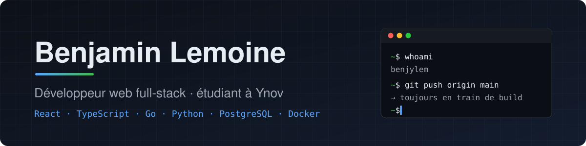

  

  
  
  

## 👋 Salut, moi c'est Benjamin

Étudiant en développement web à **Ynov**, passé par **Epitech**. J'aime les projets où il faut faire tenir ensemble un front, une API et une base de données, et les voir tourner pour de vrai.

- 🔨 En ce moment : **qcm-forge**, une app qui transforme des cours en QCM (Go, PostgreSQL, Docker)
- 🎯 Je cherche : un **stage de 5 semaines** (dès mi-mai 2027) et une **alternance** à partir de septembre 2027
- 🌱 J'apprends : CI/CD, déploiement et observabilité

## 🚀 Projets

<table>
<tr>
<td width="50%" valign="top">

### ♟️ [Chess Multigame](https://github.com/Benjylem/Chess_multigame)
Jeu d'échecs en ligne à deux joueurs, avec toutes les règles (roque, prise en passant, promotion, pat). J'ai écrit le moteur de règles, le plateau et la synchronisation des coups, et j'ai intégré le travail de l'équipe.

`React` `TypeScript` `Vite` · 45 tests unitaires · équipe de 3

</td>
<td width="50%" valign="top">

### 📚 [qcm-forge](https://github.com/Benjylem/qcm-forge)
Transforme des supports de cours (PDF, PPTX) en fiches et en QCM, chaque question renvoyant à l'extrait du cours d'où elle vient. Projet solo pensé comme un vrai pipeline : API, base de données, conteneurs, puis CI/CD.

`Go` `PostgreSQL` `React` `Docker` · en cours

</td>
</tr>
<tr>
<td width="50%" valign="top">

### 🔐 [Root Override](https://github.com/Benjylem/Python-FastAPI)
Escape game 100 % back-end : 60 minutes pour traverser 4 salles en équipe, uniquement via l'API (Swagger, curl, Postman).

`Python` `FastAPI` · tests

</td>
<td width="50%" valign="top">

### ☁️ [Corvus](https://github.com/amaaune/Corvus)
Cloud de stockage personnel qui transforme un vieux PC en serveur pour y envoyer ses fichiers et photos. Projet Ydays avec une designer et deux profils cyber.

`Go` · V0 · équipe

</td>
</tr>
<tr>
<td width="50%" valign="top">

### 🎬 [GOTCHA](https://github.com/Benjylem/YnovGotcha_website)
Site du média étudiant des Ydays Ynov, avec détection automatique du live Twitch, carrousels et chatbot. Déployé en continu sur Netlify.

`HTML` `CSS` `JavaScript` · [voir le site](https://gotcha2026.netlify.app)

</td>
<td width="50%" valign="top">

### 🏢 [Pôle Emploi Quest](https://github.com/Benjylem/Projet_RED)
RPG textuel humoristique en terminal : classes, missions, inventaire et système de craft.

`Go`

</td>
</tr>
</table>

## 🛠️ Stack

  

